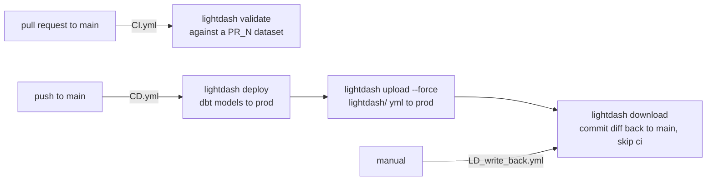

# Legacy Lightdash layer

**Retired.** Grafana replaced Lightdash as the dashboard layer
(`docs/adr/0003-grafana-over-lightdash.md`). The three Lightdash workflows were
disabled on `2026-10-09`. Nothing in this page is running. It exists so the
files it names can be deleted with confidence.

## What it was

Lightdash read metrics and dimensions straight out of dbt YAML, and charts and
dashboards were kept as `.yml` files under `lightdash/`. Production was a
Lightdash instance on Cloud Run, and `main` was meant to mirror it exactly.

The loop was **two-way**. `CD.yml` both pushed `lightdash/` to production and
downloaded production back into `main` with a bot commit. Edits made in the
Lightdash UI were overwritten on the next push, unless a write-back ran first.

## Why it mattered after retirement

`CD.yml` triggers on every push to `main` that touches anything outside
`.github/**` and `lightdash/**`. Until it was disabled, any dbt or docs push
would try to deploy to a Lightdash instance nobody uses, and its last runs sat
in `pending`. The per-PR datasets left behind by `CI.yml` (`PR_20` to `PR_25`)
are tracked in a GitHub issue.

## What can be deleted

- `.github/workflows/CI.yml`, `CD.yml`, `LD_write_back.yml` (all `disabled_manually`)
- `lightdash/` (`charts/`, `dashboards/`)
- `models/lightdash_exposures.yml`, and the `LIGHTDASH_URL` row in `docs/reference/configuration.md`
- the Lightdash Cloud Run service and its secrets in the GitHub repository settings
- `meta:` blocks in model YAML that only Lightdash read (check before removing,
  some carry descriptions dbt docs still shows)
