# Legacy v1 pipeline

**Frozen.** The last JSONL files it wrote to GCS are from `2026-02-19`. Its
workflow is disabled. Its models still build in `main`, but no dashboard reads
them. This page exists so nobody revives it by accident, and so the next design
does not repeat its mistakes.

## What it was

The official TickTick Open API returns only **open** tasks. It has no completed
tasks, no deleted tasks, no created or modified timestamps. To recover those, the
pipeline photographed the open-task list over and over and inferred history from
what changed between photos.

```mermaid
flowchart LR
  X[n8n job<br/>holds a GitHub token] -->|repository_dispatch| W[Serverless snapshot workflow<br/>on main]
  W -->|checkout ref: incremental_run_gha| F[ticktick_fetcher.py<br/>Open API, open tasks only]
  F --> L[dbt target load_snapshot<br/>DuckDB reads previous snapshot from GCS]
  L --> D[dbt target dump_snapshot<br/>dbt snapshot, then COPY back to GCS JSONL]
  D --> BQ[BigQuery external tables<br/>tasks, tasks_snapshot, projects, projects_snapshot]
  BQ --> STG[stg__ticktick__tasks on main]
```



## The two-branch arrangement

`.github/workflows/serverless_snapshot.yml` lives on `main` but checks out
`ref: incremental_run_gha`. The comment in that file explains why: a
`workflow_dispatch` or `repository_dispatch` trigger only works for workflow files on the
default branch. So the code that ran every few minutes was **not the code on
`main`**. It lived on a long-lived branch (`incremental_run_gha`, last commit
`eaec99a`, `2025-12-07`) with its own `dbt_project.yml`, `profiles.yml`,
`snapshots/snapshots.yml` and models under `models/1_load_statefull_to_mem/` and
`models/2_dump_snapshot_to_gcs/`.

The workflow has no `schedule:`. The trigger was an **n8n workflow**, run on a
self-hosted n8n server, that held a personal GitHub token allowed to send
`repository_dispatch` events of type `serverless_snapshot`. The owner recalls
the n8n server sitting on the same VPS as the poller to spread the dispatch
requests, but not how the n8n job itself was started. On `2026-10-09` that VPS
had no n8n container, process, systemd unit or install directory, so the server
is gone or lives elsewhere. Either way the token it embedded may still be valid.
The last recorded run history shows one dispatch every 15 minutes, matching
`DBT_LOAD_INTERVAL=15`:

```
2026-02-18T23:45:03Z repository_dispatch failure
2026-02-19T00:00:03Z repository_dispatch failure
2026-02-19T00:15:04Z repository_dispatch failure
2026-02-19T00:30:07Z repository_dispatch failure
2026-02-19T00:45:04Z repository_dispatch failure
```

High-frequency runs like this are why the repository was made public: GitHub
Actions minutes are free only on public repositories.

The same "one profile, many targets" switching drives which models are enabled:
`dbt_project.yml` enables the `raw` models only under `load_raw`/`stage_raw`, and
the snapshot configs are enabled only when `target.name == 'dump_snapshot'`.
`DBT_TARGET` in each workflow step picks the stage. The pipeline is spread across
target names, not across code.

## How completion was inferred, and why it was wrong

`snapshots.yml` uses `strategy: check`, `check_cols: [id]` and
`invalidate_hard_deletes: true`. So the only event a snapshot records is **a task
id disappearing from the open list**. `models/staging/ticktick/stg__ticktick__tasks.sql`
then labels every disappearance as a completion:

```sql
dbt_valid_to as completed_time,
...
2 as status
...
where dbt_valid_to is not null
```

The trap this creates is `docs/traps/V1_COUNTS_DELETED_AND_MOVED_TASKS_AS_COMPLETED.md`.

The same model also forces every live row to `status = 0`. It injects a fake task
with `task_id = '0'` whose title reads like "next load in N minutes", as a
freshness label for the dashboard.

## What can be deleted when v1 is retired

- `.github/workflows/serverless_snapshot.yml` and the `incremental_run_gha` branch
- the n8n dispatch job, wherever it lives, and the GitHub token it embeds (revoke it in GitHub settings even if n8n is gone)
- `models/staging/ticktick/base/base__ticktick__*`, `stg__ticktick__{tasks,projects,project_folder,task_tags}`
- marts without a `_v3` suffix that read them: `fct_tasks`, `dim_projects`, `dim_folders`, `fct_task_tags_bridge`, `dim_tags` (check `ref()`s first)
- the `load_raw`, `stage_raw`, `load_snapshot`, `dump_snapshot` outputs in `profiles.yml`, and the target switches in `dbt_project.yml`
- the v1 source tables in `models/staging/ticktick/source_ticktick_raw.yml`
- `models/intermediate/*.txt` (already disabled)
