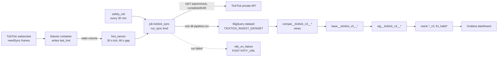

# Current pipeline: websocket hint, Dagster and dlt into BigQuery

Replaces the v3 poller (`docs/architecture/pipeline-v3.md`, now legacy). The dbt
chain and the Grafana dashboard did not change: they read the new tables through
three compat views shaped like the old raw tables.

Line numbers below are a starting point, not an address. Jump roughly there and
confirm by what the code says. If a range is off by more than a screen, fix it and
re-date this page. Deploy and operating steps are in `EL/ticktick/ingest/README.md`;
variables in `docs/reference/configuration.md`.

## Where the code lives

`EL/ticktick/ingest/` is its own uv project. One Docker image runs two containers
(`docker/docker-compose.yml`): `dagster` (webserver and daemon via `dagster dev`) and
`listener`. Both mount the named volume `state` at `/state`.

| file | lines | what lives there |
|---|---|---|
| `src/ticktick_ingest/listener.py` | ~59-108, ~135-262 | atomic `last_hint` write and read; socket session, push-token register, `hello` keep-alive, idle reconnect, reconnect backoff, exit 3 on 401 |
| `src/ticktick_ingest/defs.py` | ~56-82 | the multi-asset (one asset per table) and job `ticktick_sync` |
| `src/ticktick_ingest/defs.py` | ~106-150 | `hint_decision`, `hint_sensor`, `safety_net` schedule |
| `src/ticktick_ingest/defs.py` | ~167-213 | failure message and `ntfy_on_failure` sensor |
| `src/ticktick_ingest/defs.py` | ~219-244 | `purge_old_runs_daily`: deletes Dagster runs older than 7 days |
| `src/ticktick_ingest/pipeline.py` | ~124-185 | `plan_tasks`: gate decisions, pending flush, tombstones |
| `src/ticktick_ingest/pipeline.py` | ~195-308 | `run_sync` and `_run` (the run logic), `_add_closed` (closed history) |
| `src/ticktick_ingest/source.py` | ~84-200 | the eight dlt resources: dispositions, keys, schema contracts, bookmarks |
| `src/ticktick_ingest/gate.py` | whole file | gate cache (SQLite) and its rebuild from BigQuery |
| `src/ticktick_ingest/parse.py` | whole file | pure payload helpers; `BODY_FIELDS` and `gate_decision` |
| `src/ticktick_ingest/client.py` | ~35-75 | `resolve_x_device`: the per-stack device id |
| `src/ticktick_ingest/client.py` | ~121-197 | the two HTTP calls, `AuthRejected` on 401, retries on network errors only |
| `src/ticktick_ingest/cli.py` | whole file | `sync`, `backfill`, `reset`, `rebuild-gate` |
| `docker/dagster.yaml` | whole file | storage on the state volume, one run at a time, run monitoring, tick retention |

## Trigger: listener, hint, sensor, safety net

TickTick has no webhooks, but its web app keeps a websocket open and the server
sends a `needSync` frame for every change. The **listener** holds that socket the
way an open browser tab does. On every `needSync` frame, and on every (re)connect
(frames sent while disconnected are lost), it writes the current time in ms to
`$INGEST_STATE_DIR/last_hint`. It never fetches anything itself.

**Pushes go to one socket per device id.** When a second listener registered under
the same `X-Device` id, the first one stopped receiving frames without any error,
while sockets under different ids each get every push. So the fetcher and the
listener replace the header's `id` with one derived from the compose project name
(`INGEST_STACK_NAME`, or `TICKTICK_DEVICE_ID` when set): a dev stack started with
another `-p` name has its own channel. The listener logs the id it uses at start.

**Silence is normal, so the listener reconnects when idle.** The server sends
nothing between changes: no reply to `hello`, no heartbeat. A socket whose
registration was taken over looks the same as a quiet account. After
`INGEST_LISTENER_IDLE_MINUTES` (default 60) without a frame, the listener logs
`no frame for 60 min; reconnecting now` and reconnects without backoff. The
reconnect writes one hint, like any connect.

`hint_sensor` ticks every 30 s. It launches `ticktick_sync` with `kind=hint` when
`last_hint` is newer than the hint it last launched for **and** the last launch was
over 60 s ago. A hint inside the gap is not lost: the cursor stays put and a later
tick picks it up. `safety_net` runs the same job with `kind=safety` every 30 minutes
whatever the hints say. `dagster.yaml` caps the instance at one run at a time, so two
runs never race the same bookmark.

**A run cut off by a container stop is failed after 30 minutes.** It stays STARTED
with no process behind it and would hold the single run slot forever. `dagster dev`
uses the default run launcher, which cannot check whether a worker is alive, so run
monitoring in `dagster.yaml` catches it only by `max_runtime_seconds` (1800): past
it, the run is marked failed, `ntfy_on_failure` alerts, and queued runs start.
`enabled: true` alone would leave it STARTED. A real run that takes over 30 minutes
is failed the same way.

| kind | started by | what it does beyond fetching the delta |
|---|---|---|
| `hint` | `hint_sensor` | an empty delta loads nothing and creates no load job |
| `safety` | `safety_net`, `cli sync --kind safety` | always loads; flushes every pending body edit; pages closed tasks back to the cursor |
| `backfill` | `cli backfill` | as `safety`, but pages closed tasks down to the oldest the endpoint returns |
| `reset` | `cli reset` | fetches from checkpoint 0 and merges every task, skipping the gate |

## The body-edit gate

Typing in a task body sends a sync hint about every 10 s, and each would otherwise
be a BigQuery MERGE. The gate compares every incoming task with a fingerprint of the
version last merged into `tasks`, computed over every field except `content`, `desc`,
`modifiedTime` and `etag`. If only those changed (or nothing did, as on a replayed
update), the task is held as **pending** in the gate cache and not merged. Any run
that merges at least one row, and every `safety`/`backfill` run, also flushes every
pending task. So a body edit reaches `tasks` with the next real change, or within
30 minutes. Pending edits are still appended to `raw_task_changes` at once.

## Tables

Every row carries `_run_id` (Dagster run id, or `manual-<uuid>` from the CLI),
`_extracted_at` (UTC time of the HTTP response) and `_bookmark` (the checkpoint or
completion cursor the fetch started from), plus dlt's own columns. Nested values stay
JSON; timestamps stay as TickTick's strings.

| table | write | content |
|---|---|---|
| `raw_task_changes` | append | one row per entry of every lane (`update`, `delete`, `deletedInTrash`, `deletedForever`), whole entry in `payload` |
| `raw_lists`, `raw_folders` | append | the whole lists or folders array as one row, only when its hash changed |
| `raw_closed_tasks` | append | one row per closed-history item loaded |
| `tasks` | merge, upsert on `id`, hard delete | current state of every task seen in `update[]`, plus `raw_json` |
| `closed_tasks` | merge, upsert on `id` | current state of every closed-history item, plus `raw_json` |
| `lists`, `folders` | replace | every list or folder, whenever the delta carries them |

The raw tables are the history: they never lose a row. `tasks` is current state
only. A task in any delete lane becomes a tombstone row that dlt's hard-delete
column removes from `tasks`. Tombstones are sent only for ids the gate cache says are
in `tasks`, because an upsert of an unknown id would insert it. An update and a
delete of the same id in one delta: the update wins, since a restore from trash
arrives as an update while the delete lanes are still replaying.

Typed tables freeze data types: a field that changes type fails the run and fires the
alert. New columns are allowed. The raw tables accept anything.

## Bookmarks and the completion cursor

Both bookmarks live in dlt resource state, which dlt commits in the destination in
the same load as the rows. Data and bookmark move together or not at all. Each run
starts with `sync_destination()`, so a fresh working dir resumes from BigQuery.

- **Checkpoint** (on `raw_task_changes`): the sync-feed position to fetch from next.
- **Completion cursor** (on `raw_closed_tasks`): the newest `completedTime` loaded.

The closed-history endpoint pages backwards from now, about 1,000 rows a page.
`safety` runs, and any run whose delta closed a task, page back until they reach the
cursor. The last page fetched mostly holds tasks closed long before it, all
loaded already. **Incremental runs keep only rows completed at or after the cursor**
(inclusive, deduped on `id`); otherwise every safety run would re-append about a
thousand old rows to `raw_closed_tasks` and rewrite their `closed_tasks` rows. Only
`backfill` keeps every row it pages through.

## Compat views: why the v3 dbt models did not change

`models/staging/ticktick/base/compat/compat__ticktick_v3__{tasks,projects,groups}.sql`
return exactly the columns, names and types of the old external tables. The three
`base__ticktick_v3__*` models read them through `ref()` instead of the old source;
nothing downstream changed, and reverting those three lines rolls back. Every field
comes from `raw_json`, because dlt renames typed columns to snake_case.

`compat__ticktick_v3__tasks` unions `tasks` and `closed_tasks` and keeps one row per
id: newest `modifiedTime`, then `tasks` over `closed_tasks`, then the later
`_extracted_at`. An old closed-history row therefore never overrides a newer state
from the sync feed, such as a reopen. `deleted` is always `0` (hard deletes are gone
already) and `account_id` is `'default'`. `compat.yml` tests each id column for
`unique` and `not_null`; `tests/compat/test_compat_ticktick_v3_shape_matches_legacy_source.sql`
fails when a view's columns or types drift from the legacy source declarations.

The source schema is `env_var('TICKTICK_INGEST_DATASET', 'ticktick_ingest')`; dbt and
the stack must point at the same dataset.

## Failure alert

`ntfy_on_failure` posts every failed run to `NTFY_URL` with the title
`ticktick-ingest failed`, the first 300 characters of the error and the run id.
Without `NTFY_URL` it only logs.

**`cookie rejected: paste a fresh t`** as the first line means TickTick answered 401
somewhere in the error chain: the `t` cookie expired or the session was signed out.
Nothing retries a 401 and there is no scripted login. The listener exits with code
3 on the same condition, and Docker restarts it into the same failure. Every
30-minute safety run fails and alerts again until a fresh cookie is in the `.env` and
the containers are recreated (`EL/ticktick/ingest/README.md`, "Alerts"). Network
errors are retried twice inside a run and are never reported as a cookie problem.

## Where state lives, and rebuilding it

| state | where | if lost |
|---|---|---|
| checkpoint, completion cursor, list and folder hashes | dlt state in BigQuery | the source of truth |
| dlt working dir | `$INGEST_STATE_DIR/dlt` | restored from BigQuery by the next run |
| gate cache | `$INGEST_STATE_DIR/gate.db` | rebuilt from `tasks.raw_json` on the next run (`cli rebuild-gate` forces it) |
| pending body edits | inside the gate cache | dropped, but already in `raw_task_changes`; the next edit to the task re-captures it |
| `last_hint` | `$INGEST_STATE_DIR/last_hint` | the listener rewrites it on connect |
| Dagster runs, ticks, sensor cursor | `$INGEST_STATE_DIR/dagster` | run history only; nothing the pipeline needs |

Nothing on the host is the only copy of anything. Removing the `state` volume costs
run history and any pending body edits, nothing else. The CLI and Dagster share the
dlt working dir: do not run a CLI command while a run is in progress.

The one host-level dependency is boot order. When the UI is published on a
Tailscale address, `docker.service` must start after Tailscale has that address,
or the `dagster` container stays down after a reboot without alerting. A systemd
drop-in template for that lives in `EL/ticktick/ingest/docker/host/`; see
`docs/traps/INGEST_STACK_ABSENT_AFTER_HOST_REBOOT.md`.

## Known gaps

- **A closed task deleted later stays closed.** Deleting a closed task removes it
  from `tasks` and from the closed-history endpoint, but nothing deletes its row in
  `closed_tasks`, so `compat__ticktick_v3__tasks` keeps showing it as closed.
- **Tasks in archived or deleted lists drop out of "open".** A load from checkpoint
  0 (the first load, `cli reset`) returns no tasks of archived or deleted lists, and
  archiving or deleting a list emits no task deltas. Tasks of lists archived before
  the last checkpoint-0 load are absent; tasks of lists archived after it stay in
  `tasks` with their last state. The legacy replica kept stale rows for all of them,
  so open-task counts are lower than the legacy numbers by those tasks. Reading
  archived lists' tasks needs per-list calls this pipeline does not make.
- Completion caveats that predate this pipeline (won't-do, reopen, recurring tasks)
  are in `docs/known-gaps.md`.
