# Current pipeline: v3 poller to Grafana

> **Legacy.** The v3 dbt models no longer read the poller's GCS Parquet tables. The
> current pipeline is described in `docs/architecture/pipeline-ingest.md`. The body
> below is kept as written for whoever still runs or retires the poller.

```mermaid
flowchart LR
  TT[TickTick web-app sync<br/>/api/v3/batch/check/&#123;checkpoint&#125;] -->|poll every 30 s| P[poller<br/>FastAPI + SQLite replica]
  P -->|DuckDB COPY, after each changed cycle| G[GCS bucket<br/>ticktick/v3/*.parquet]
  G -->|external tables| R[BigQuery ticktick_raw<br/>tasks_v3, projects_v3, groups_v3]
  R --> B[base__ticktick_v3__*]
  B --> S[stg__ticktick_v3__*]
  S --> M[marts *_v3, fct_habit*]
  M --> D[Grafana dashboard<br/>gtd-main-tasks-v3]
```

Line numbers below are a starting point, not an address. Jump roughly there and
confirm by what the code says. If a range is off by more than a screen, fix it and
re-date this page.

## Extraction: the poller

`EL/ticktick/v3/poller/` is a small FastAPI app. It runs in one container on a
Linux host (`EL/ticktick/v3/docker/docker-compose.yml`).

| file | lines | what lives there |
|---|---|---|
| `service.py` | ~100-226 | the poll loop: fetch delta, merge, emit, sleep; error classification and the two halt rules |
| `repository.py` | whole file | SQLite merge: upsert tasks, delete on `delete[]`, full-replace projects and groups |
| `client.py` | ~10-30 | the HTTP call; replays the browser's `User-Agent` and `Cookie` |
| `auth.py` | ~15-55 | parses a pasted browser "copy as cURL" into a credential profile; requires the `t=` cookie |
| `emitter.py` | ~35-140 | DuckDB `COPY ... TO 's3://<bucket>/<prefix>/{tasks,projects,groups}.parquet'` |
| `webapp.py` | ~214-360 | `/health`, `/metrics`, `/status`, `/cycles`, `/profiles/import-curl`, `/poll/run-once`, `/poll/start`, `/poll/stop` |
| `config.py` | ~27-64 | every `TICKTICK_V3_*` setting and its default |

**The loop does not restart itself.** Any HTTP error from TickTick stops it at once.
Three network errors in a row also stop it. To resume, import a fresh cURL through
the web UI (if the cookie expired), then `POST /poll/start`. The metric
`ticktick_poller_state{loop_running="0"}` and an ntfy alert through Alertmanager are
the only signals. See `docs/adr/0005-poller-halts-on-any-rejection.md`.

Each Parquet file is a **full snapshot of the replica**, rewritten after every cycle
that changed state. It is not an append log. BigQuery always sees the current
replica and nothing older.

## Warehouse: dbt on BigQuery

All models are views. `profiles.yml` picks the dataset per target (`dev`, `prod`,
`CI`). The external tables are declared in `models/raw/external_table_stage/dump.yml`
and created with `dbt run-operation stage_external_sources`.

| layer | models | job |
|---|---|---|
| base | `base__ticktick_v3__{tasks,projects,groups}` | cast typed Parquet columns; fall back to `raw_json` JSON paths when a column is null |
| staging | `stg__ticktick_v3__{tasks,projects,project_folder}` | drop deleted rows, derive `completed_time`, GTD work type |
| marts | `fct_tasks_v3_semantic_base`, `fct_tasks_v3_due_workload_daily`, `fct_tasks_v3_grain_rollup`, `fct_tasks_v3_completed_activity`, `dim_*_v3` | the dashboard's semantic layer |
| habits | `fct_habit`, `fct_habit_streaks` | tasks tagged `habit`; streaks keyed by title |

Data tests for the v3 marts are in `tests/marts/`. One of them pins the known
orphan-project gap.

The v1 chain (`base__ticktick__*`, `stg__ticktick__*`, `fct_tasks`, `dim_projects`,
`dim_folders`) still builds alongside. Nothing in Grafana reads it. See
`docs/architecture/legacy-v1-snapshot.md`.

## Presentation: Grafana

See `docs/architecture/grafana-dashboards.md`.
